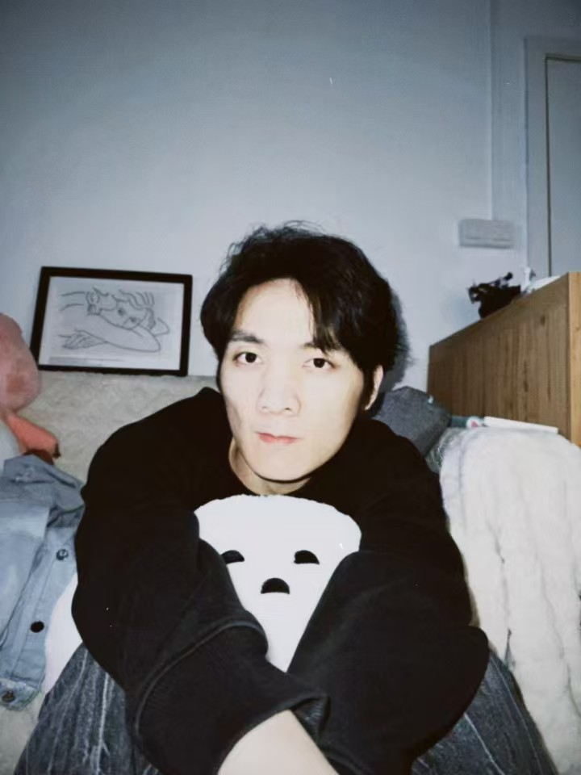

# 王开发 · 作品集（小白改稿手册）

## 一句话说明
整个网站只有 **一个文件**：`index.html`。用记事本或 VS Code 打开它，改完保存，浏览器刷新就生效。

---

## 一、怎么打开和预览
1. 双击 `index.html`，会用浏览器打开（推荐 Chrome / Edge）。
2. 页面里的视频在网络上（CDN），所以打开时要联网。

---

## 二、换首页那 6 张精选卡（带注释版）
1. 打开 `index.html`，按 `Ctrl + F` 搜索 `FEATURED`。
2. 会看到一段被 `/* ... */` 包起来的说明，下面有 6 行网址，每行后面都有 `// ① ...` 这种注释。

```
const FEATURED = [
  "https://...",   // ① 第 1 张：地盘抢夺 · 沙漠对峙
  "https://...",   // ② 第 2 张：弹射小球 · 十字准星混剪
  ...
];
```

3. 这 6 张在页面上的位置是：

| 第 1 行 | ① 左 | ② 中 | ③ 右 |
|---|---|---|---|
| 第 2 行 | ④ 左 | ⑤ 中 | ⑥ 右 |

4. **换某一张**：把那一行引号里的网址换成新视频网址，注释里的文字也一起改掉方便以后认。
5. **调顺序**：把整行（网址 + 注释）上下移动。
6. **只放 4 张**：删掉两行，注意剩下的行之间要留英文逗号，最后一行结尾不要逗号。

> 网址必须能在下面的 `DATA` 里找到，否则那张卡会空白。最稳的办法：在 `DATA` 里搜到想要的作品，复制它 `u:"..."` 里的地址过来。

---

## 三、换「关于」区的人物自拍
1. 把自拍图片准备好，命名成 `selfie.jpg`（竖版 3:4 或 4:5 最好，长边 1200px 左右，文件别超过 1MB）。
2. 把 `selfie.jpg` 放到和 `index.html` **同一个文件夹**里。
3. 打开 `index.html`，搜索 `person` 附近或直接搜 `7i72Jm81Q2`，会看到：

```

```

4. 把这一行改成：

```

```

5. 保存、刷新，照片就换成你的自拍了。照片上压着的名字在下面两行：`<b>王开发</b>` 和 `<span class="en">Wang Kaifa</span>`，要改名字就在这儿改。

> 上传到网站时，记得 **`selfie.jpg` 要和 `index.html` 一起传上去**，不然图片会显示不出来。

---

## 四、加一条 / 删一条作品
1. 搜 `const DATA = [`，这里是全部 75 条作品。
2. 每行格式：

```
{t:"标题", u:"视频地址", c:"分类", o:"V"}
```

- `t` 卡片标题
- `u` 视频直链
- `c` 分类，只能是 5 个之一：`AI 创意` / `游戏` / `风格模板` / `ae 特效` / `实拍剪辑`
- `o` 竖版填 `V`，横版填 `H`

3. **加一条**：复制任意一行，粘贴在后面，改掉 `t`、`u`，行尾补上英文逗号。
4. **删一条**：整行删掉，别留下多余逗号。

> 标签上显示的数量（21 / 20 / 7 …）是自动算的，不用手动改。

---

## 五、改文字内容
直接搜关键词就能定位：

| 想改什么 | 搜索关键词 |
|---|---|
| 首屏三行大标题 | `KAIFA,` / `WANG` / `Visual Designer.` |
| 首屏那句介绍 | `以视觉叙事驱动创意` |
| 关于区自我介绍 | `2020 年进入游戏买量素材行业` |
| 自我评价 | `乐观开朗` |
| 工作经历 | `冰川网络` / `翻江倒海` / `湖南鹿鹿白` |
| 教育信息 | `湖南工业大学` |
| 六张能力卡 | `视觉体系` / `AI 生成与控制` |
| 联系区大标题 | `有项目合作` |
| 邮箱 / 电话 / 微信 | `1396384161` / `187-1135-5008` / `Whim-7K` |
| 页脚 | `WANG KAIFA` / `All rights reserved` |

---

## 六、最容易踩的坑
1. **引号**：只能用英文双引号 `"`，中文引号会让整页白屏。
2. **逗号**：数组里每行之间要有英文逗号 `,`，最后一行不要。
3. **改错救不回来**：改之前先复制一份 `index.html` 备份，坏了直接把备份改回名字。
4. **白屏排查**：浏览器按 `F12` 打开控制台，红色报错会写明第几行。

---

## 七、部署上线（把链接发给 HR）
任选一个平台，把 `index.html`（以及 `selfie.jpg`，如果用了）一起传上去：

1. **Netlify** — app.netlify.com，把文件夹直接拖进去，几秒后得到公网地址。
2. **Vercel** — vercel.com，New Project 上传文件夹。
3. **Cloudflare Pages** — Workers & Pages → Direct Upload。
4. **GitHub Pages** — 建仓库上传文件 → Settings → Pages。
5. **自己的服务器 / 宝塔 / OSS** — 放到网站根目录，或对象存储开静态网站托管。

想要自己的域名：在平台里绑定域名，加一条 CNAME 指向平台给的地址即可。

---

## 八、视频说明
- 现有 81 条都是 **完整时长 + 保留原音** 的版本，统一压到 720p，合计约 121MB。
- 卡片悬停时自动循环预览为 **静音**；点击卡片弹出的灯箱 **默认有声**，右下角按钮可切静音。
- 浏览器不允许页面自动播放带声音的视频，所以首屏不会自动出声，这是正常现象。
- `ae 特效` 那 20 条原片本身只有 4 秒左右，所以它们短是正常的。
